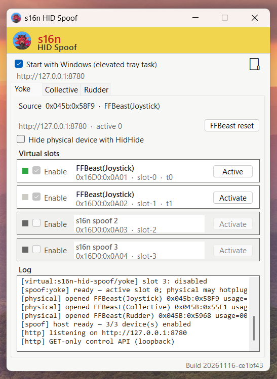

# s16n-hid-spoof

Windows app that takes **up to three physical USB HID controllers** and presents each as **up to four virtual devices** with different identities. Input is passed through 1:1. You pick which virtual device is live per physical from the UI or over HTTP.

Made for [FFBeast](https://ffbeast.com/) flight controls that share the same VID:PID — each stick/yoke can look like a different device to the sim. Use a tab per physical (Yoke / Stick / Rudder by default).

Also helps with **[SPAD.next](https://www.spadnext.com/)**: the virtual devices stay present if a physical controller restarts or hotplugs, so SPAD does not see the device disappear and come back.



## Install

Download: https://github.com/stuart11n/s16n-releases/releases/download/hid-spoof-latest/s16n-hid-spoof-setup.exe

The installer is small (framework-dependent). If needed, it downloads and installs the **.NET 10 Desktop** and **ASP.NET Core** runtimes during setup.

Run the app **as Administrator**. Close or minimize sends it to the taskbar. Optional **Start with Windows** starts it in the notification area only (no taskbar button) at logon. Use the tray menu **Exit**, or close from the taskbar, to quit. The folder icon opens the config directory.

Plug each enabled physical controller in at least once so the app can **record its HID report descriptor**. After that, virtual devices start with the real button/axis layout even if the stick is unplugged (hotplug still works). Cache files live under `%LOCALAPPDATA%\s16n-hid-spoof\` (`physical-profile-{id}.hm.json`).

Optional: enable **Hide physical device with HidHide** on a device tab so games only see the virtual device(s). Requires [HidHide](https://github.com/nefarius/HidHide) installed. Close the HidHide Client first — only one app can talk to the driver at a time.

## Config

Edit:

`%LOCALAPPDATA%\s16n-hid-spoof\appsettings.json`

Created on first launch. Older single-device configs are migrated automatically into `Devices[0]` (Yoke) with Stick/Rudder disabled placeholders.

| Setting | What it does |
|---------|----------------|
| `Devices` | Exactly three entries (tabs) |
| `Devices[n].Id` / `Name` | Stable id for HTTP + tab title |
| `Devices[n].Enabled` | Turn a whole physical tab on or off |
| `Devices[n].Physical.Vid` / `Pid` | Real controller |
| `Devices[n].Physical.DevicePathContains` | Optional path substring when several units share VID:PID |
| `Devices[n].VirtualDevices[0..3]` | Up to four virtual devices per physical |
| `Devices[n].ActiveSlot` | Which slot starts active (`0..3`) |
| `Devices[n].ForwardOutputToPhysical` | Send force-feedback / rumble back to the real device |
| `Http.Url` | Control URL (default `http://127.0.0.1:8780`) |

## HTTP (GET only)

Default: `http://127.0.0.1:8780` (this PC only).

| URL | What it does |
|-----|----------------|
| `/health` | Process up + per-device running/ready |
| `/status` | All devices |
| `/devices/{id}/status` | One device (`yoke`, `stick`, `rudder`, …) |
| `/devices/{id}/slots` | Virtual slot list for that device |
| `/devices/{id}/active?slot=2` or `/devices/{id}/active/2` | Switch slot on that device |
| `/devices/{id}/ffbeast/reset` | FFBeast flight reset for that device |

```bash
curl -s http://127.0.0.1:8780/health
curl -s http://127.0.0.1:8780/status
curl -s http://127.0.0.1:8780/devices/yoke/slots
curl -s "http://127.0.0.1:8780/devices/yoke/active?slot=2"
curl -s "http://127.0.0.1:8780/devices/yoke/ffbeast/reset"
```

## Building from source

Windows 10/11 x64, .NET 10 SDK, run as Administrator.

```powershell
.\scripts\fetch-hidmaestro.ps1
dotnet run --project src\S16nHidSpoof -c Release

.\scripts\package.ps1    # installer → dist\
.\scripts\release.ps1    # publish installer to s16n-releases (hid-spoof-latest)
```
